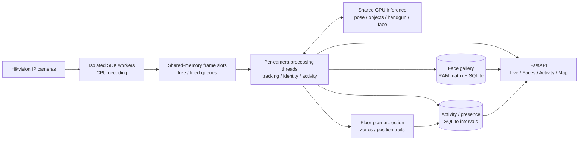

# Detect — Multi-Camera People & Activity Analytics

An on-premise computer-vision platform that turns Hikvision camera streams into live people tracking, face recognition, activity timelines and floor-plan routes — with shared GPU inference and a browser-based operator workspace.

> Showcase repository: functionality, architecture, model configuration, measured results and interface screenshots. Application source, model weights, proprietary SDK binaries and underlying operational databases are private. Selected real camera frames are included below.

[Projects](https://maks-grigoryan.github.io/projects/) · [Portfolio](https://maks-grigoryan.github.io/portfolio/) · [Architecture](docs/architecture.md) · [Models](docs/models.md) · [Features](docs/features.md) · [UI gallery](docs/interface.md)

---

## What it does

- **Live multi-camera analytics** — annotated camera grid, adjustable layout, camera reordering and live status, grouped by branch.
- **People and pose tracking** — 17-keypoint human pose estimation, custom track memory and optical-flow propagation between detector updates.
- **Face recognition** — SCRFD face detection and ArcFace embeddings, automatic grouping of repeated sightings, named and unnamed people, editable person cards and duplicate-card merging.
- **Identity continuity** — combines recent face evidence with clothing colour and position to keep an identity when a face turns away; one current name owner prevents the same identity being assigned to several tracks simultaneously.
- **Activity estimation** — sitting / standing and working / on-phone / idle labels, using pose geometry, tracked objects, hand contact and temporal smoothing.
- **Time accounting** — presence intervals, work / phone / idle totals, long-idle episodes, daily summaries and 3 / 7 / 30-day reports.
- **Floor-plan intelligence** — uploaded or drawn floor plans, camera placement, calibration, editable zones, live positions, zone routes and day replay.
- **Handgun detection** — a custom YOLO26m detector runs alongside the people pipeline; detected objects are highlighted in the camera view.
- **Branch and camera management** — shared people database across branches, camera assignment, per-camera model switches and cross-branch identity alerts.

## Operator workspace

*Focused Live view of the busiest sampled camera, captured from the running application on 15 October 2026. The people, pose skeletons, object boxes and activity labels come from the real camera pipeline.*

*Additional selected live-camera panels. Frames were chosen independently during the sampling window; they are not presented as a synchronized instant.*

| Activity and time accounting | Live floor plan and replay |
|---|---|
|  |  |

*All interface screenshots are from the running application and real records. The floor plan is the saved two-room branch layout, with its actual camera calibration state and projected tracks. The Activity screenshot shows the stored report for 2 October 2026. More views: [interface gallery](docs/interface.md).*

## How it works

1. **Capture** — each camera owns an isolated Hikvision SDK process. Decoded frames travel through shared memory rather than serialized frame payloads.
2. **Infer** — shared TensorRT models serve requests from camera threads; greedy batch queues combine requests already waiting. Pose and handgun inference target 6 Hz, object detection 1 Hz.
3. **Track and identify** — optical flow propagates keypoints, object trackers preserve context, and face / clothing / position evidence updates identity ownership.
4. **Record** — stable state changes become intervals; overlapping observations are merged for duration totals rather than summed per camera.
5. **Project and inspect** — calibrated ground-plane positions become live map markers, zone visits and replay trails; FastAPI serves the operator UI.

## Models

| Component | Model / method | Runtime configuration |
|---|---|---|
| Human pose | **YOLO11s-pose**, 17 keypoints | TensorRT FP16, 736 × 1280, dynamic batch up to 8, target 6 Hz |
| Scene objects | **YOLO26x**, selected COCO classes | TensorRT FP16, 1088 × 1920, batch 1, target 1 Hz; optional calibrated INT8 engine |
| Handguns | **Custom YOLO26m** | TensorRT FP16, 1088 × 1920, dynamic batch up to 4, target 6 Hz |
| Face detection | **SCRFD-10G**, InsightFace `antelopev2` | ONNX Runtime CUDA; default 160 × 160 head-crop detection |
| Face embeddings | **ArcFace `glintr100`** | Normalized 512-dimensional vectors; recognition batches up to 8 |
| Activity | Pose / object-contact rules + memory | Independent posture and activity labels; no separately trained action model |
| Clothing | Keypoint-defined ROIs + HSV colour analysis | No additional neural network; repeated observations and colour consistency |
| Position | Ground-plane homography | At least four image-to-plan point pairs; zone membership and trail sampling |

The deployed custom weapon checkpoint contains **one class: `handgun`**. The pipeline accepts class names for a future knife model, but knife support is not claimed for these weights. [Model details and thresholds →](docs/models.md)

## Custom handgun model — validation results

| Training and validation | Value |
|---|---|
| Architecture | YOLO26m, fine-tuned single-class detector |
| Dataset split | 30,644 train / 1,789 validation / 2,276 test image files |
| Recorded run | 100 epochs, training image size 1280, batch 4 |
| Validation precision | **0.8979** |
| Validation recall | **0.7783** |
| Validation mAP50 | **0.8449** |
| Validation mAP50–95 | **0.6047** |

*The figure above is the original `results.png` saved by the training run, copied without redrawing. Metrics are from epoch 100 of the local training log. The deployed `weapon.pt` matches that run's `best.pt` byte-for-byte. These are validation metrics for the handgun detector, not end-to-end system accuracy or a test-set result. The dataset split counts describe the configured single-class training directory; dataset images and annotations are not redistributed.*

## Performance and engineering

Actual capture-session measurements on **Intel Core Ultra 9 285K + NVIDIA RTX 5080**, recorded on **15 October 2026**. Three of the four configured camera streams were connected during capture.

| Measurement | Observed value |
|---|---|
| Application process-group CPU, mean | 3.089 core equivalents |
| System GPU utilization, mean | 24.95% |
| System GPU memory, mean | 11563.70 MiB |
| Sampling | 20 samples over 21.0 seconds |
| Saved map | 2 rooms, 2 zones, 4 placed cameras; 2 explicitly calibrated |

The CPU group includes the application and its camera workers. GPU counters are system-wide and include other active GPU processes during UI capture. This short observation is not an inference-only benchmark or a capacity guarantee. The actual samples are in [runtime-sample.csv](docs/runtime-sample.csv), and capture / artifact hashes are in [capture-provenance.json](docs/capture-provenance.json). [Measurement context →](docs/performance.md)

The implementation isolates native camera failures, shares model memory, schedules inference by elapsed time and records state changes instead of writing every frame. A gallery matrix keeps face matching in memory while SQLite remains the durable copy.

## What I built

- The complete camera-to-dashboard integration: SDK capture, process isolation, shared-memory transport, camera processing threads and model batch queues.
- Multi-signal identity handling: face gallery, track continuity, clothing observations, ownership handover and branch sightings.
- Pose / hand-object activity logic, stable label transitions, interval-based time accounting and report generation.
- A custom handgun detector, model export and deployment through TensorRT, plus FP16 / INT8 runtime paths for the relevant models.
- A floor-plan tool with drawing, camera placement, calibration, zones, live projection and route replay.
- The operator interface: branches, live camera grid, people database, activity reporting, map and camera management.
- Measurement scripts and regression checks for identity ownership, floor geometry and clothing ROI equivalence.

## Documentation

| Guide | Contents |
|---|---|
| [Feature reference](docs/features.md) | Complete operator functionality and behaviour |
| [Architecture](docs/architecture.md) | Processes, queues, inference, identity and persistence |
| [Model reference](docs/models.md) | Models, exports, class thresholds, recognition and training provenance |
| [Interface gallery](docs/interface.md) | Original UI screenshots and navigation |
| [Performance](docs/performance.md) | Recorded measurements, verification and scaling limits |
| [API surface](docs/api.md) | The application's 53 HTTP routes |
| [Deployment](docs/deployment.md) | Hardware, runtimes, configuration and operational boundaries |

## Current scope

The implemented application runs several logical branches on one workstation. Distributed branch synchronization, GPU video decoding and a second-stage weapon classifier remain future work. Activity labels estimate visible interactions; they are not a validated measurement of employee productivity. The current application requires a controlled access layer for shared deployment, and its identity-merging and date-boundary paths have known edge cases described in [deployment notes](docs/deployment.md).

This repository documents the system and does not contain a runnable application package. The selected camera stills, actual UI records and saved floor-plan view are shown above. Complete operational databases, face embeddings, camera credentials, raw network configuration and continuous recordings are not distributed.

## Stack

`Python` `Ultralytics` `PyTorch` `TensorRT` `ONNX Runtime CUDA` `InsightFace` `OpenCV` `NumPy` `FastAPI` `Uvicorn` `SQLite WAL` `multiprocessing` `shared_memory` `HTML` `CSS` `JavaScript` `SVG`
