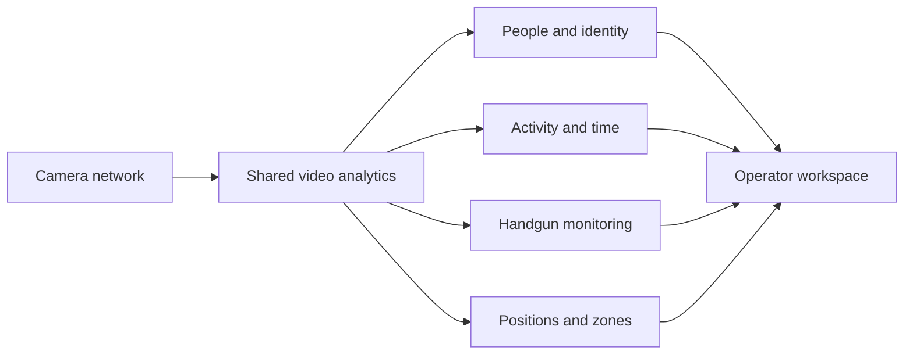

# AI ANALYTOX

### Multi-camera intelligence, engineered for efficient operation

AI ANALYTOX brings live video analytics, face recognition, activity reporting and floor-plan monitoring into one operator workspace. I built the complete camera-to-insight system, with particular attention to how CPU, GPU, memory and storage are used as the camera workload grows.

[Projects](https://maks-grigoryan.github.io/projects/#ai-analytox) · [Portfolio](https://maks-grigoryan.github.io/portfolio/#projects)

## What the system delivers

- **Live camera supervision** — multiple camera views with people tracking, identity labels and visual analytics.
- **People recognition and continuity** — a shared identity workspace, searchable person cards and continuity across camera views.
- **Activity and time reporting** — sitting / standing and working / on-phone / idle estimates, presence history and daily or period summaries.
- **Spatial monitoring** — a floor-plan editor, camera placement, named zones, live positions and route replay.
- **Weapon monitoring** — handgun detection integrated into the live camera view.
- **Branch and camera management** — location-based workspaces, connection status and configurable analytics for each camera.

## Engineering decisions and resource efficiency

The main engineering challenge was coordinating camera capture, several AI tasks, identity tracking, history and live viewing on shared hardware. I optimized the work between these stages so that adding an analysis feature does not require duplicating an entire processing stack.

### Shared AI resources

I organized GPU inference as a shared resource serving multiple cameras. Model reuse limits repeated GPU allocations, while coordinated requests make better use of the loaded models. Optimized inference runtimes support efficient execution on the available GPU.

### Processing budgets for each task

Each analysis task has its own execution schedule. Tracking and state continuity keep the camera view useful between heavier inference updates. Camera-specific analytics switches let a deployment spend compute on the features needed for each view.

### Efficient frame handling

I reduced overhead in the path from camera decoding to analysis, limited frame-buffer memory and avoided unnecessary image conversions and transfers. Image operations focus on the relevant regions where possible, keeping temporary allocations and repeated pixel processing under control.

### Independent analysis and live viewing

Camera analysis continues when an operator closes a browser view. Display encoding is requested for active viewers, allowing the system to concentrate resources on analytics when live video is not being watched.

### Compact operational history

History follows meaningful state changes and movement. Buffered position recording and retention controls limit write pressure and storage growth, while keeping the information needed for time reports, zone history and replay.

### Camera failures remain local

Camera connections run independently, with connection monitoring, controlled startup, reconnection and explicit session shutdown. Authentication failures pause further login attempts, helping prevent a rejected camera connection from continuously extending a device lockout.

| Engineering focus | Practical result |
|---|---|
| Shared inference resources | Multiple cameras reuse loaded AI models |
| Task scheduling | Heavy analysis runs according to its own workload budget |
| Controlled frame buffers | Frame memory has defined limits |
| Focused image operations | Less repeated pixel processing and temporary allocation |
| Viewing on demand | Display encoding follows active operator views |
| Event-based history | Reports and replay use compact operational records |
| Independent camera recovery | A camera connection can recover separately |

## Operator workspace

| Floor-plan editor | People database |
|---|---|
|  |  |

| Camera management | Branch overview |
|---|---|
|  |  |

## From video to operational insight

The same workspace connects live observations with person records, activity history and the floor plan. Operators can move from a camera view to an identity, a time report or a route without switching between separate tools.

## Models

| Task | Model / method |
|---|---|
| People and pose | YOLO11s-pose |
| Scene objects | YOLO26x |
| Handgun detection | Custom YOLO26m |
| Face detection and recognition | SCRFD + ArcFace |
| Activity and spatial analysis | Temporal analysis and calibrated floor mapping |

## Custom detector — validation results

The custom YOLO26m handgun detector was trained with 30,644 training images and evaluated on a validation split of 1,789 images.

| Validation metric | Result |
|---|---|
| Precision | **89.79%** |
| Recall | **77.83%** |
| mAP50 | **84.49%** |
| mAP50–95 | **60.47%** |

