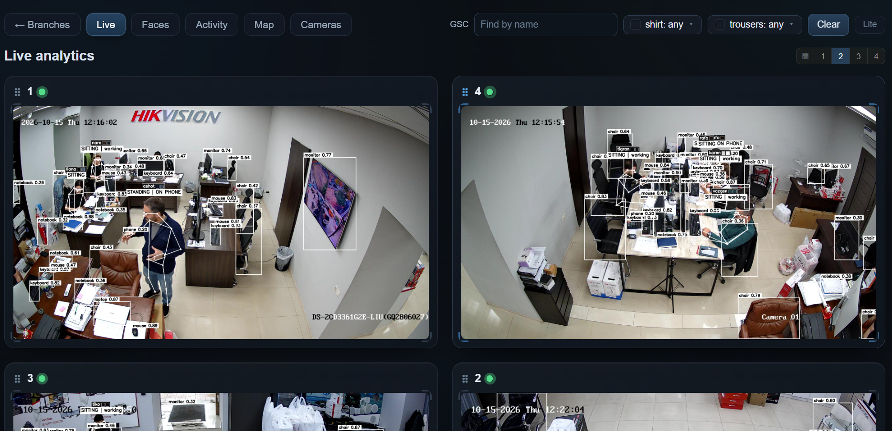
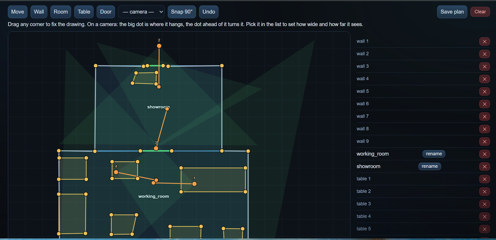
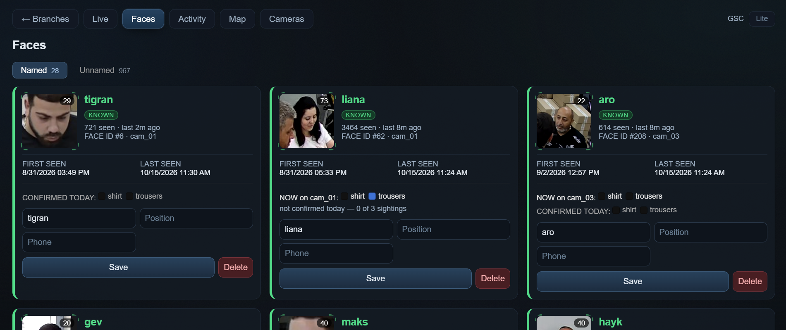
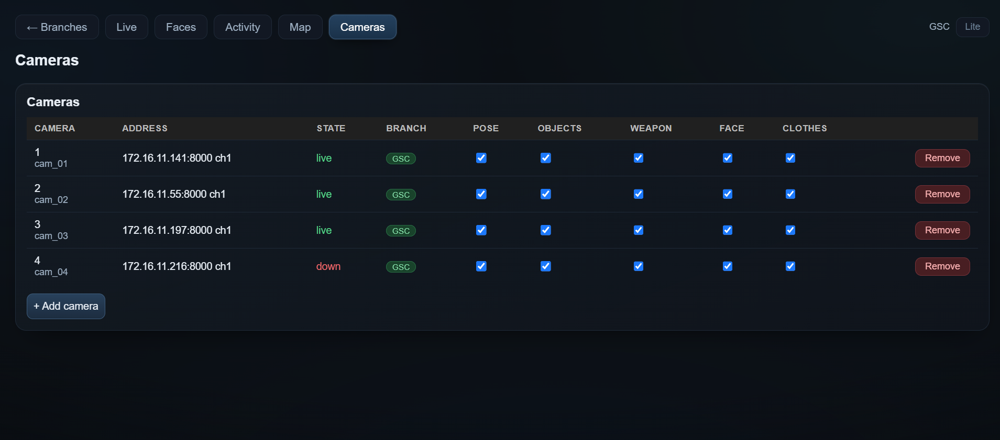
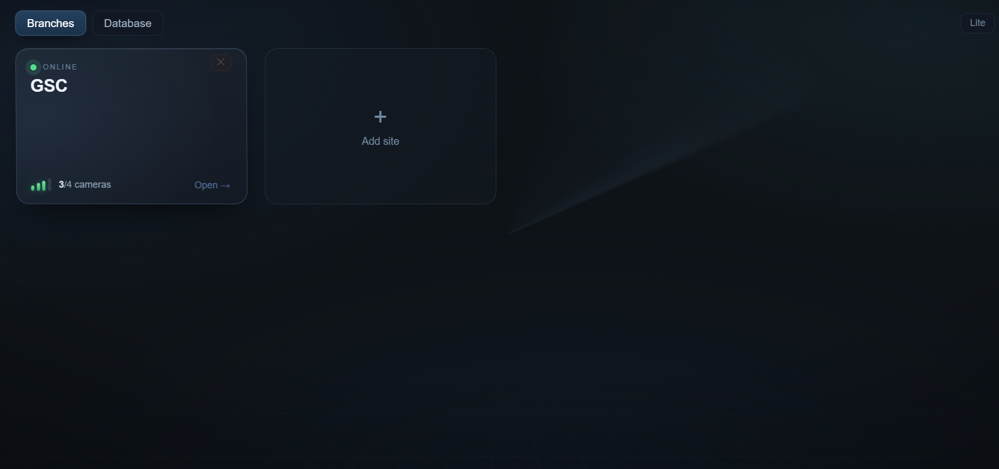
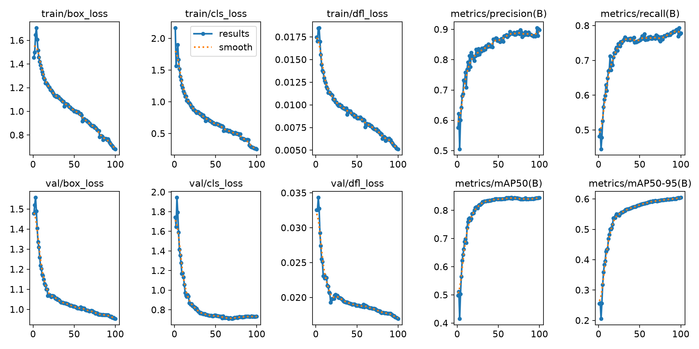

# AI ANALYTICS

A multi-camera video analytics platform with people tracking, face recognition, activity reports, handgun detection and floor-plan monitoring.

[Projects](https://maks-grigoryan.github.io/projects/#ai-analytics) · [Portfolio](https://maks-grigoryan.github.io/portfolio/#projects)

## Live analytics

The live workspace shows multiple camera feeds with people tracking, recognized names, posture and activity labels, scene objects and handgun detections. Camera panels can be reordered and arranged in different layouts, with connection status visible for each view.

Operators can find a person by name or search by clothing appearance. The same camera workspace brings together observations from the different analysis tasks, while branch selection keeps the views organized by location.

## People and identity

The people database groups repeated face sightings into person cards. Named and unnamed people have separate views, with face samples, sighting counts, first and last appearance, camera references and profile information.

An operator can name a person, edit profile fields, inspect samples and merge duplicate cards. The shared identity workspace connects sightings across camera views and branches, while track continuity preserves identity as a person moves through a scene.

## Activity and time reports

Posture and activity are recorded separately: a person can be sitting or standing while working, using a phone or appearing idle. Presence history is retained alongside these activity estimates.

Daily reports show presence, work / phone / idle totals and first / last appearance. Period summaries cover several days, while idle reports show current or historical episodes. Camera and zone routes connect time records with the person's movement through the monitored space.

## Floor plans and movement

The floor-plan workspace supports an uploaded plan or a drawing with walls, rooms, doors and furniture. Cameras can be placed on the plan with their orientation and coverage directions, and named zones can be added to the layout.

Camera calibration connects observations with positions on the plan. The map shows live positions, recorded zone visits and movement trails. Historical replay includes a timeline and person selection, so an operator can review movement together with the relevant rooms and cameras.

## Handgun detection

A custom YOLO26m detector identifies handguns in camera images and displays detections in the live view. It operates alongside people, identity and activity analysis within the same camera workspace.

## Cameras and branches

Branch workspaces group cameras, maps and zones by location. Camera management shows connection status, branch assignment and selectable analysis features for pose, scene objects, handguns, faces and clothing.

The people database remains shared across branch workspaces. Camera assignment and analysis settings can be managed through the interface, and connection monitoring is part of normal operation.

## Interface

| Floor-plan editor | People database |
|---|---|
|  |  |

| Camera management | Branch overview |
|---|---|
|  |  |

## System organization

Camera connections run independently and feed a shared AI runtime. Tracking, recognition, activity analysis and map observations update the same operational records. Live views, person cards, reports and replay use these observations throughout the workspace.

| Component | Operation |
|---|---|
| Camera connections | Independent capture, status monitoring, reconnection and session shutdown |
| AI runtime | Shared model instances with separate schedules for the analysis tasks |
| Frame handling | Defined buffer limits and image operations on relevant regions |
| Tracking | Person and state continuity between analysis updates |
| Live viewing | Camera analysis continues independently of the currently open browser view |
| History | Activity changes, position recording, retention settings, reports and replay |

Processing, live viewing and history management have separate responsibilities within the system. A camera connection can be monitored and recovered independently, while the operator continues to use the other views and records.

## Models

| Task | Model / method |
|---|---|
| People and pose | YOLO11s-pose |
| Scene objects | YOLO26x |
| Handgun detection | Custom YOLO26m |
| Face detection and recognition | SCRFD + ArcFace |
| Activity and spatial analysis | Temporal analysis and calibrated floor mapping |

## Detector validation

The custom YOLO26m handgun detector uses 30,644 training images and a validation split of 1,789 images.

| Validation metric | Result |
|---|---|
| Precision | **89.79%** |
| Recall | **77.83%** |
| mAP50 | **84.49%** |
| mAP50–95 | **60.47%** |

