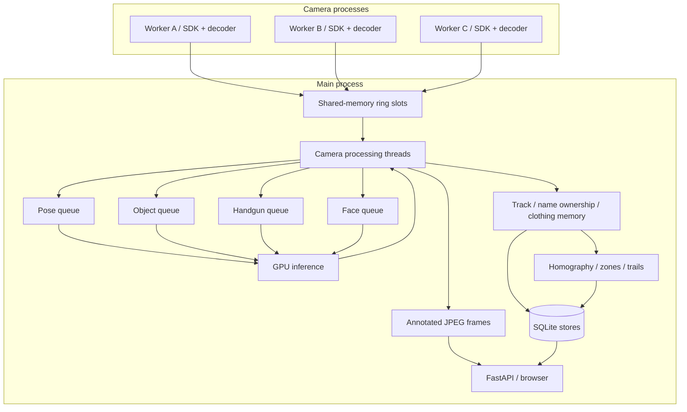

# System architecture

## Process and memory boundaries

Each camera runs a dedicated worker process around the Hikvision HCNetSDK / PlayM4 decoding stack. The SDK remains outside the CUDA / web process. Native failure in one worker can therefore be detected and recovered without directly taking down the main process.

Workers write raw decoded frame pixels into a fixed set of shared-memory slots. Free-slot and filled-slot queues carry small references and frame dimensions. This avoids sending full frame arrays or JPEG payloads through `multiprocessing.Queue`.

One processing thread per camera consumes those slots. The main process owns the models, identity state, persistence and HTTP application. The shared GPU batchers are the single inference entry point for their model instances.

## Scheduling and batching

Detector scheduling is based on elapsed time, with tolerance for the frame-arrival grid, rather than every Nth frame. Camera frame rates can vary without silently changing the intended inference frequency.

The batcher blocks for the first request, then greedily collects requests already queued. It does not add an artificial batching delay. The pose engine supports up to eight inputs, the deployed handgun engine four, and the static scene-object engine one. ArcFace embedding extraction batches faces after per-crop detection.

Lucas–Kanade optical flow propagates skeleton keypoints between pose runs. Dedicated phone and scene-object tracking preserve context between object detections. Display-frame preparation is separate from the low-frequency detector updates.

## Identity state

The gallery stores normalized 512-dimensional face vectors in a NumPy matrix with owner IDs. SQLite contains the durable person and sample records. Matching is matrix–vector multiplication, followed by thresholding and a preference margin for named identities.

Track identity uses recent face checks, missed-check counters, clothing consistency and position references. A process-wide ownership table allows one current `(camera, track)` owner per person. Ownership changes are also reflected in open activity intervals.

Clothing colour is sampled from keypoint-defined torso and leg regions. ROI-sized masks avoid allocating a whole-frame mask for every person. Repeated independent sightings establish daily clothing memory; disagreement can delay confirmation.

## Persistence

| Store | Data |
|---|---|
| Face store | Person cards, face samples, embeddings, clothing observations, branch sightings and branch alerts |
| Analytics store | Presence / posture / activity / zone intervals, identity events, settings and sampled positions |
| Configuration | Branches, cameras, model switches, camera calibration, drawn plan and zones |

Both SQLite stores use WAL and `synchronous=NORMAL`. State transitions are persisted rather than duplicating every observed frame. Presence and activity intervals serve different purposes, allowing posture changes without fragmenting presence history.

Position trails are sampled no more than once per second when movement is significant, with a slower heartbeat for people who remain still. Buffered writes and a retention task limit database growth.

## Recovery and boundaries

The implementation contains worker monitoring, staggered camera startup, reconnection, graceful SDK shutdown, stale-track cleanup and downtime repair. These mechanisms are implemented, but not a claim of fault-free operation: partial-start resource cleanup and some cross-store identity changes need hardening.

The current identity-ownership map lives in one process. Splitting cameras across GPU processes or hosts therefore requires explicit ownership partitioning or synchronization; simply copying the same dictionary design would change the semantics.

The web UI is served as inline HTML / CSS / JavaScript, including an SVG map layer. It can run without external frontend libraries or a hosted inference service.
