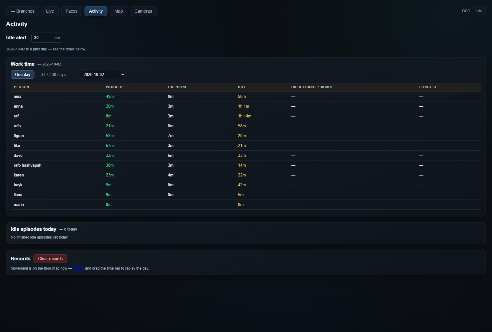
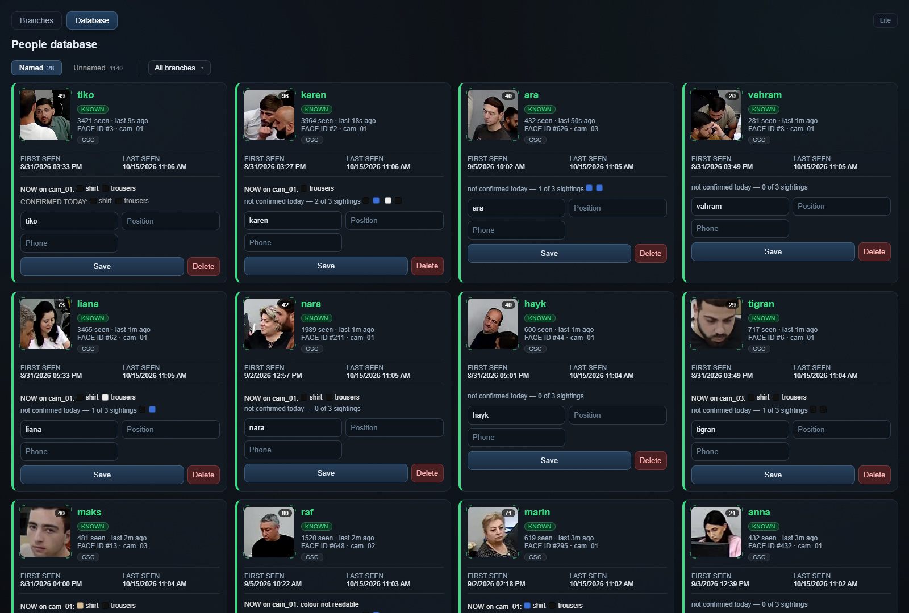
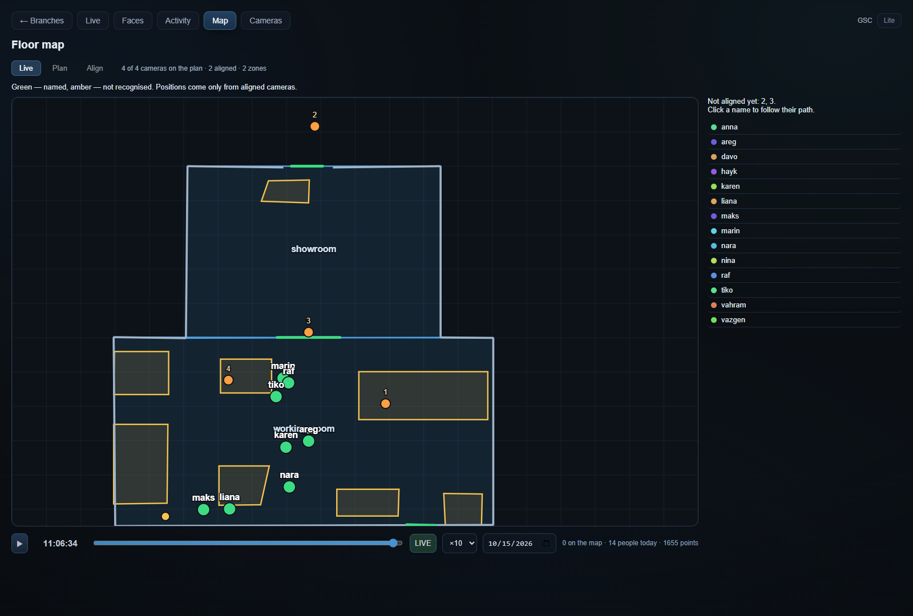
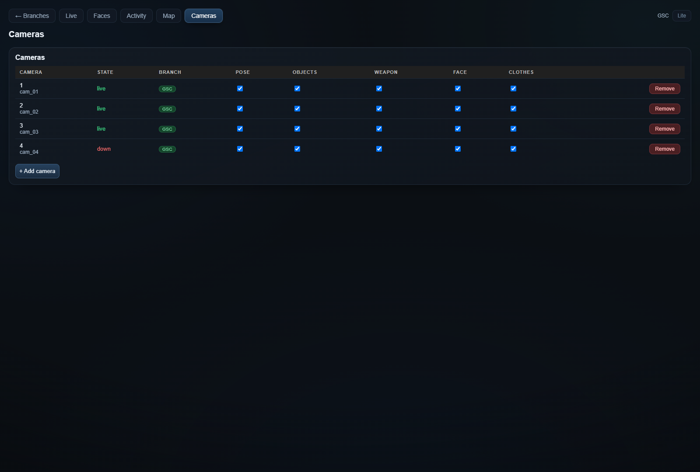
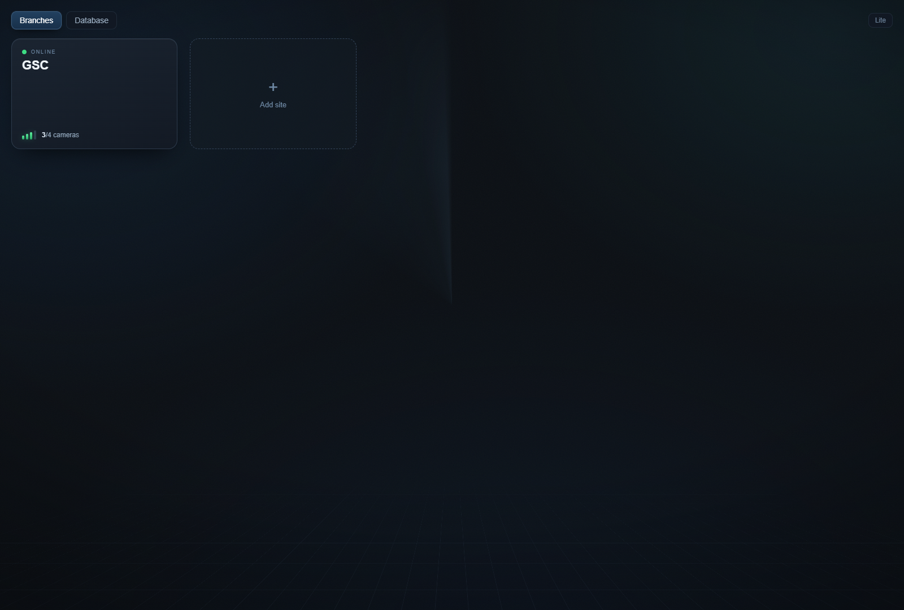

# Operator interface — actual application captures

Every image below comes from the running application, its real camera streams, saved branch configuration or real stored records. The capture date is 15 October 2026. Camera addresses are omitted from the Cameras screenshot; no replacement addresses, invented identities, placeholder face pictures or reconstructed office geometry are used.

## Live analytics

The busiest selected camera view, with the actual application's pose skeletons, object detections, identities and activity labels.

The panels use independently selected real frames from the capture window. Camera on-screen clocks can differ from the workstation clock.

## Full-resolution camera frames

These are the original annotated JPEG snapshots returned by the running application.

## Activity and time

This is the application's stored report for **2 October 2026**, selected through its day picker. The names, work / phone / idle totals and threshold come from the real database and settings.

## People database

Real named cards, retained camera face crops, sighting counts, timestamps, clothing observations and branch membership. The captured list contains 28 named identities; no invented employee cards or illustrated avatars are inserted.

## Saved floor map and actual positions

The branch's existing **working_room / showroom** layout, read directly from its saved configuration: two rooms, eight furniture polygons, two zones and four placed cameras. Two cameras have explicit calibration; the interface correctly identifies cameras 2 and 3 as not aligned. The markers and replay list come from actual observations and recorded positions.

## Camera management

Actual configured cameras, connection status and model switches. The network-address column is omitted from the published capture. One camera was unavailable during this session; its actual disconnected state is preserved.

## Branch overview

The configured branch and its real camera counts, fetched by the original page from the running application.

[Capture provenance and image hashes](capture-provenance.json)
