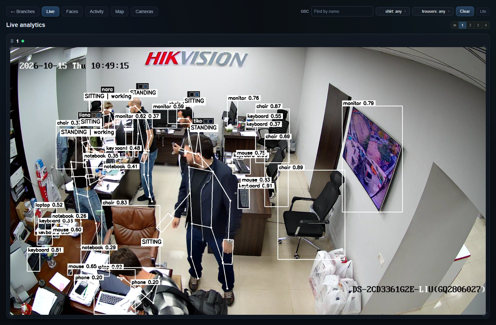
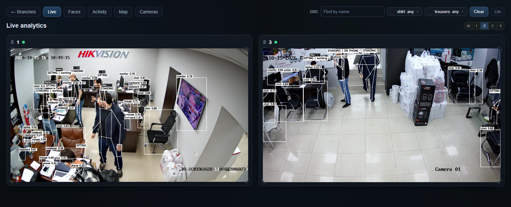
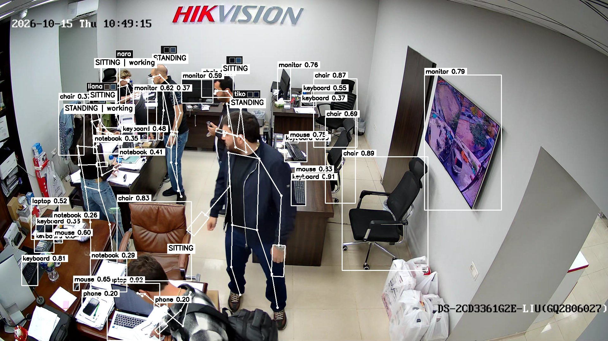
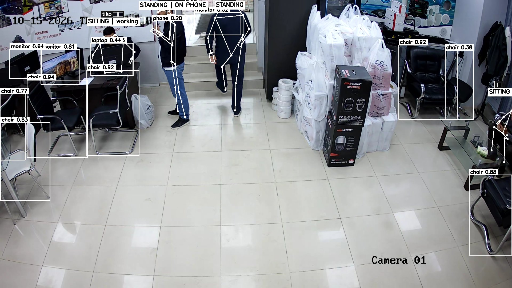
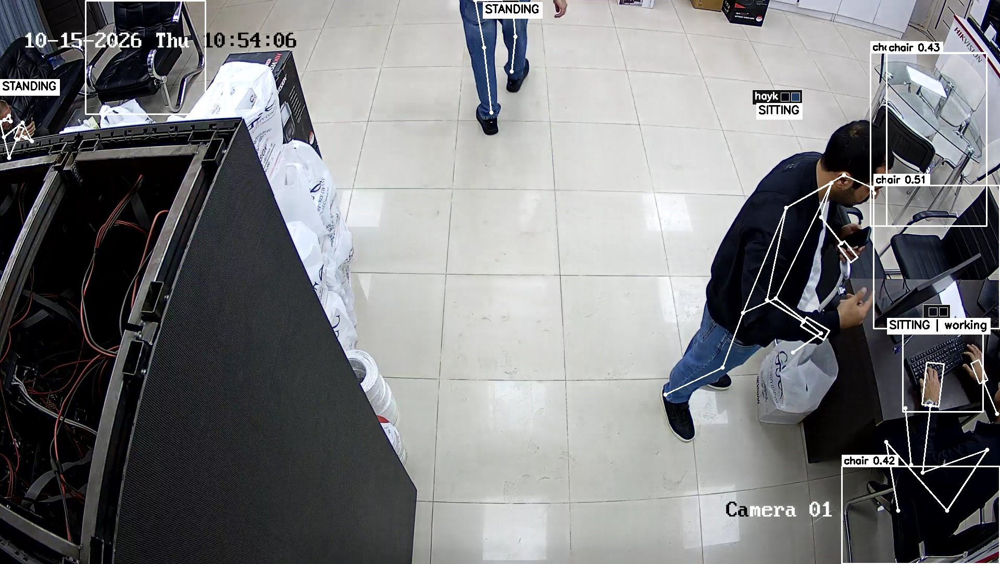
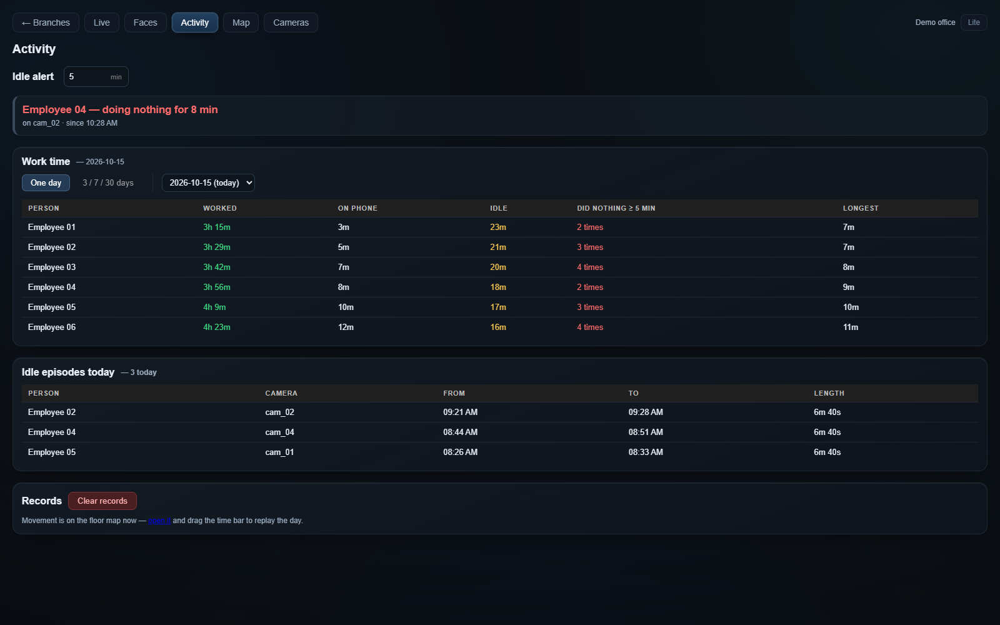
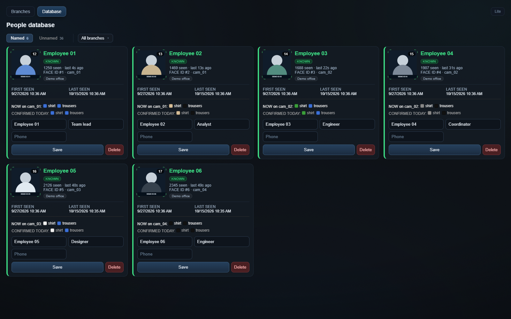
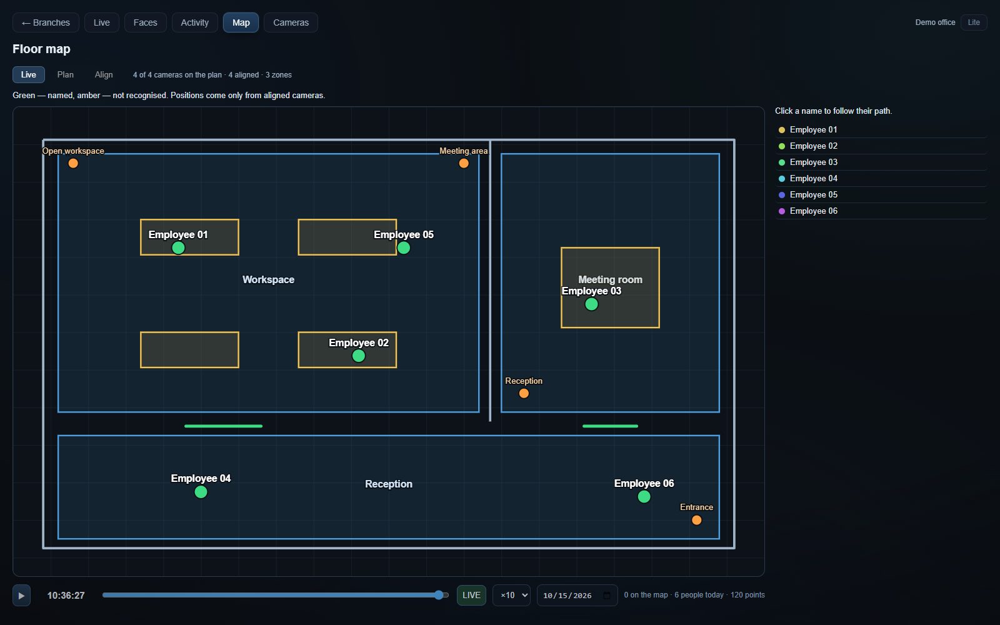
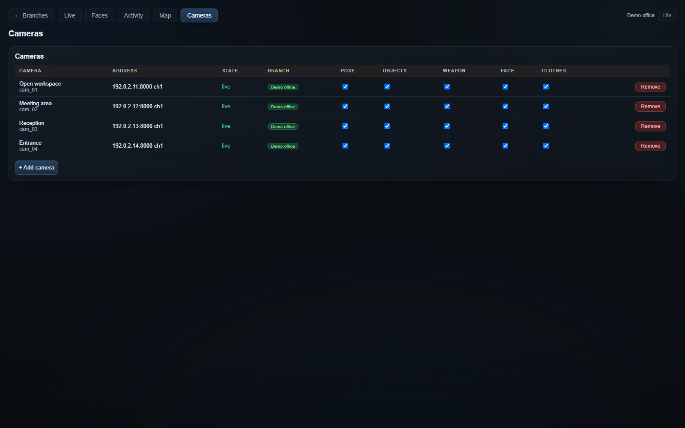
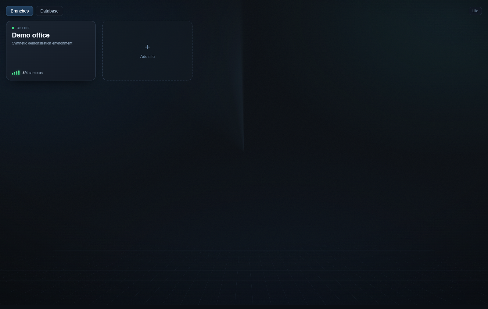

# Operator interface

The Live screenshots and camera stills below are real captures from the running application on 15 October 2026. The remaining Activity, People Database, Map, Cameras and Branches screenshots are explicitly synthetic demonstration examples. Camera credentials and operational databases are not distributed.

## Live analytics

The Live workspace combines camera status, annotated panels, name search and shirt / trouser colour filters. Operators can reorder panels and choose one, two, three or four columns. The focused screenshot shows the busiest sampled camera. Its people, scene objects, skeletons and activity labels are outputs of the actual application.

These panels use independently selected frames from the busiest views during a two-minute sampling window, rather than a claim that they occurred at exactly the same moment. Camera on-screen clocks may differ from the workstation clock.

### Full-resolution camera frames

*Real annotated frame from camera 01; selected by active-track count and image sharpness during the capture window.*

*Real annotated frame from camera 03; selected by active-track count and image sharpness during the capture window.*

*Real annotated frame from camera 02; selected by active-track count and image sharpness during the capture window.*

## Activity and time

The Activity page contains the idle threshold, current long-idle list, daily totals and historical idle episodes. The same view switches to 3 / 7 / 30-day reports. Values in this image are demonstration fixtures, not operational measurements.

## People database

The global database separates named and unnamed people, with editable cards and branch membership. The branch-level Faces page uses the same card system with its scope already selected. Avatar illustrations stand in for face crops.

## Floor map and replay

Live, Plan and Align modes share a floor-plan workspace. Operators can draw geometry, place cameras, align image-to-plan coordinates, inspect zones and replay a day's route. The synthetic layout demonstrates four aligned cameras and three zones.

## Camera management

Connection status, branch assignment, model switches and the camera-add form are separate from the Live grid. Documentation addresses use the reserved `192.0.2.0/24` example range.

## Branch overview

The entry page selects a branch before opening its Live, Faces, Activity, Map or Cameras workspace. The global People Database remains accessible separately.
