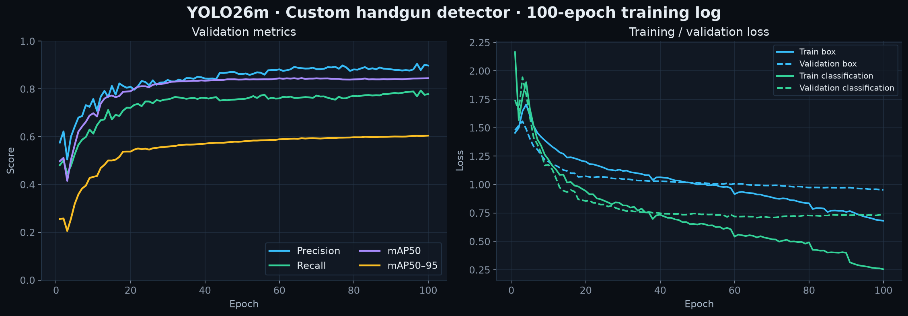

# Models, thresholds and training provenance

The runtime configuration below is verified against the application constants and the deployed TensorRT engine metadata. Export metadata records Ultralytics **8.4.78** for these engine artifacts. Dimensions are listed as height × width.

## Deployed neural models

| Purpose | Checkpoint | Input | Export | Batch limit | Target frequency |
|---|---|---|---|---|---|
| Human pose | YOLO11s-pose | 736 × 1280 | Dynamic TensorRT FP16 | 8 | 6 Hz |
| Scene objects | YOLO26x | 1088 × 1920 | Static TensorRT FP16 | 1 | 1 Hz |
| Handgun detection | Custom YOLO26m | 1088 × 1920 | Dynamic TensorRT FP16 | 4 | 6 Hz |
| Face detection | SCRFD-10G, `antelopev2` | Default detector canvas 160 × 160 | ONNX Runtime CUDA | Per head crop | By track recognition schedule |
| Face recognition | ArcFace `glintr100` | 112 × 112 aligned face | ONNX Runtime CUDA | 8 faces | Same recognition schedule |

The application prefers a sibling `.engine` file when present and otherwise loads the `.pt` checkpoint. A separately exported calibrated INT8 scene-object engine is selectable through `OBJ_ENGINE=int8`. FP16 is the default deployed object path; the mere presence of an INT8 file is not an accuracy-equivalence result.

## Scene-object subset

Only classes relevant to office context are requested from the general COCO detector.

| COCO ID | Application label | Confidence threshold |
|---|---|---|
| 56 | Chair | 0.35 |
| 60 | Table | 0.35 |
| 62 | Monitor, using the COCO `tv` class | 0.30 |
| 63 | Laptop | 0.40 |
| 64 | Mouse | 0.35 |
| 66 | Keyboard | 0.35 |
| 67 | Cell phone | 0.35 |
| 73 | Book / notebook / paper proxy | 0.25 |

The last label is deliberately a proxy: the detector does not have a dedicated office-document class. The application tracks scene boxes and hand interactions between detector runs.

## Custom handgun detector

The deployed model is a fine-tuned **YOLO26m** with a single class, `handgun`. The runtime class-name filter also lists `knife` for future checkpoints, but the current engine metadata confirms that knife is absent from the deployed weights.

| Training artifact | Verified value |
|---|---|
| Training directory | Single-class handgun dataset |
| Image files | 30,644 train / 1,789 validation / 2,276 test |
| Recorded epochs | 100 |
| Training image size | 1280 |
| Training batch size | 4 |
| Augmentation settings | Horizontal flip 0.5, HSV colour augmentation, translation 0.1, scale 0.5, mosaic 1.0; close mosaic for final 10 epochs |
| Runtime confidence | 0.25 |
| Runtime image size | 1088 × 1920 |
| Runtime target | 6 Hz, whole-frame inference |

The training log's strongest mAP50–95 entry is epoch 100:

| Metric | Validation value |
|---|---|
| Precision | 0.89790 |
| Recall | 0.77831 |
| mAP50 | 0.84494 |
| mAP50–95 | 0.60474 |



The deployed `weapon.pt` and the run's `best.pt` have the same SHA-256:

```text
f47f9ddbcb8114c778813dc3fff032588431640c7e052e2d5b47f05fae805e4c
```

This establishes checkpoint provenance. It does not establish cross-camera accuracy, identity accuracy or a held-out test-set score. Dataset split counts are file counts in the configured training directories. The source dataset, labels and checkpoints remain private. The numeric training series is included as [weapon-metrics.csv](weapon-metrics.csv).

## Face recognition

SCRFD detects faces; ArcFace produces L2-normalized 512-dimensional embeddings. Dot product therefore provides cosine similarity against stored gallery vectors.

| Setting | Default |
|---|---|
| Gallery match threshold | 0.40 |
| Minimum similarity to attach a new name | 0.50 |
| Named-card preference margin | 0.10 |
| Normal sample cap per person | 20 embeddings; merging preserves samples from both cards |
| Retry for unnamed tracks | 0.5 seconds |
| Verify a named track | 2 seconds |
| Enrollment interval | 3 seconds |
| Minimum enrollment detector confidence | 0.55 |
| Face detector threshold | 0.45 |
| Misses before dropping a name | 2, subject to continuity / hysteresis logic |
| Name-claim freshness window | 3 seconds |

These are tuned application defaults, not universal recognition thresholds. No separate measured face-recognition precision, recall or false-acceptance rate is available in the showcased artifacts.

## Activity and clothing methods

Activity classification combines 17-keypoint pose geometry, chair context, extended hand rectangles, detected work objects, phone tracking and temporal contact memory. It produces a posture label and a set of activity labels, allowing posture and phone use to coexist. It is not an action-recognition neural network and should not be described as a trained productivity classifier.

Clothing uses HSV distributions in keypoint-defined torso / leg ROIs. The current clothing path does not use the PAR, CLIP or MobileCLIP artifacts that are present among development experiments. Colour votes, repeated sightings and recent position support identity continuity.

## Experiments versus current runtime

- The default weapon path is the custom single-class detector. An open-vocabulary YOLOE path is experimental and is not the basis of the validation table above.
- A crop-based second-stage weapon classifier is planned, not deployed.
- The scene-object INT8 engine exists as an optional runtime variant; FP16 remains the default configuration.
- Archived pose engines and old clothing-model exports do not indicate that all models run simultaneously.

No model binaries, proprietary SDK libraries or biometric embeddings are distributed in this showcase repository.
