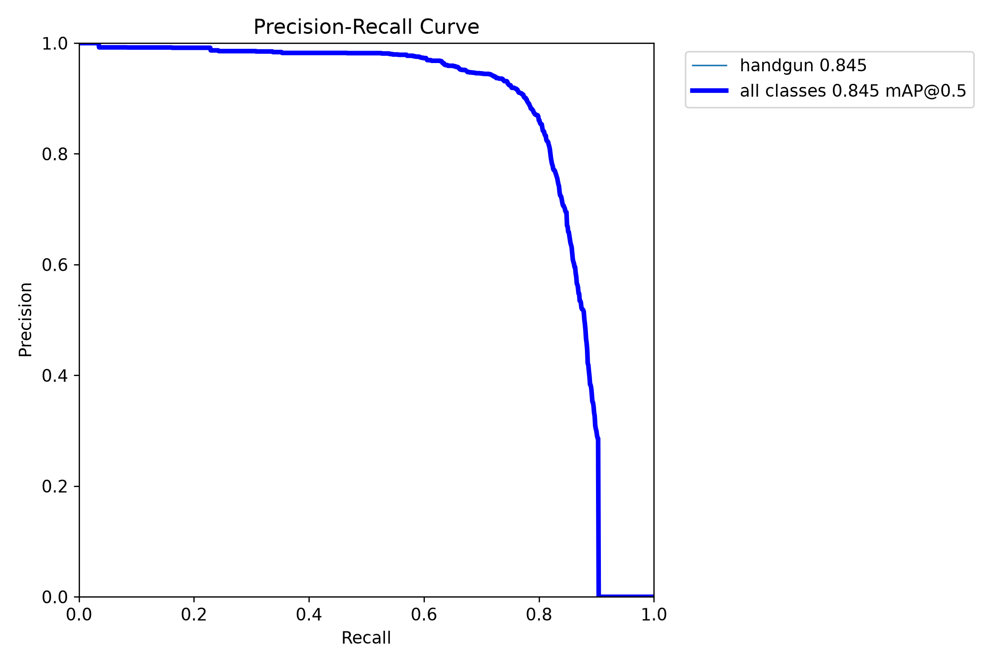
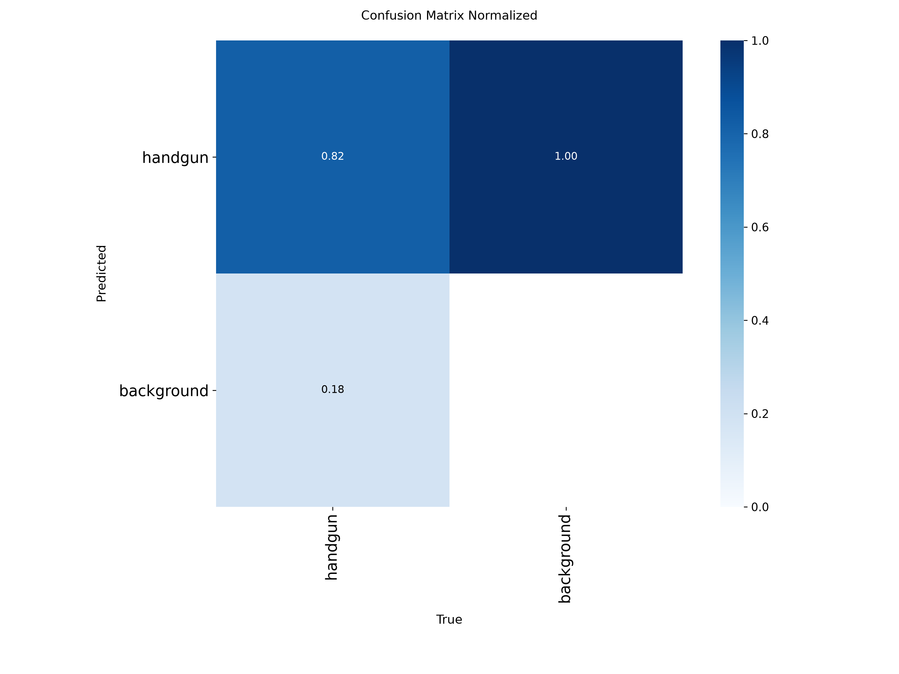

# AI ANALYTICS models

| Task | Model / method |
|---|---|
| People and pose | YOLO11s-pose |
| Scene objects | YOLO26x |
| Handgun detection | Custom YOLO26m |
| Face detection and recognition | SCRFD + ArcFace |
| Activity and spatial analysis | Temporal analysis and calibrated floor mapping |

## Custom detector validation

The custom YOLO26m handgun detector uses 30,644 training images and a validation split of 1,789 images.

| Validation metric | Result |
|---|---|
| Precision | 89.79% |
| Recall | 77.83% |
| mAP50 | 84.49% |
| mAP50–95 | 60.47% |

